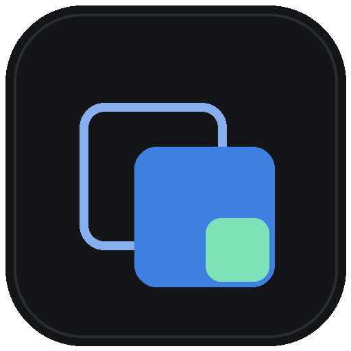
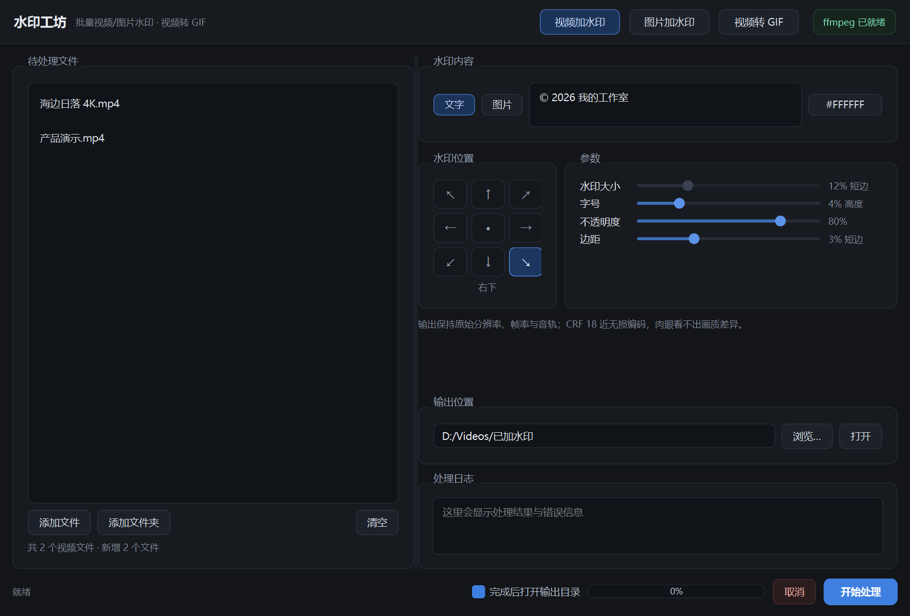
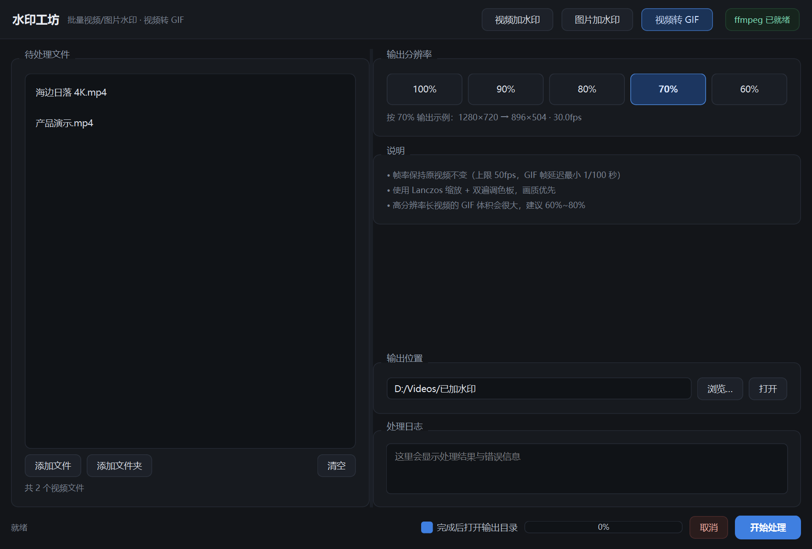

<div align="center">



# 水印工坊

**批量视频 / 图片加水印 · 视频转 GIF**

一个本地运行的 Windows 桌面工具。文字水印、图片水印、九宫格定位、批量拖拽，
**视频保持原分辨率与原帧率**，GIF 按原片比例缩放。全程不联网，素材不出本机。


📥 [下载客户端](https://github.com/yumng666/WatermarkStudio/releases/latest) · 💬 [反馈问题](https://github.com/yumng666/WatermarkStudio/issues)

</div>

**v1.0.0**：视频水印、图片水印、视频转 GIF 三合一。视频与图片**共用同一套水印参数**，
输出到九宫格任意位置，尺寸按画面比例计算，4K 与 720p 混批观感一致。



---

## 功能

### 视频批量加水印

- 文字水印与图片水印（PNG/JPG/WebP/BMP），中文与 emoji 正常渲染
- 拖入多个文件或整个文件夹（含子目录）批量处理，自动去重
- **保持原分辨率、原帧率、原音轨**：不缩放、不加 `-r`、`-fps_mode passthrough` 保留 VFR、音频 `copy`
- libx264 CRF 18，肉眼看不出画质差异；10bit 或音频不兼容时自动降级重试
- 九宫格位置：左上 / 正上 / 右上 / 正左 / 居中 / 正右 / 左下 / 正下 / 右下，边距可调
- 输出容器跟随源文件（mp4/mov/mkv/avi），其余格式输出 mp4

### 图片批量加水印

- 与视频**同一套设置面板**，参数完全一致
- JPEG 用 `quality=keep` 保存，避免二次压缩；PNG/WebP/TIFF 保留透明通道
- 保留 EXIF / ICC / DPI，自动处理手机照片方向

### 视频批量转 GIF

- 分辨率按原片百分比输出：**100% / 90% / 80% / 70% / 60%**
- 帧率保持原片（上限 50fps，GIF 帧延迟最小 1/100 秒）
- Lanczos 缩放 + 双遍调色板（palettegen / paletteuse），画质优先
- 界面实时显示「原始尺寸 → 输出尺寸 → 帧率」

### 通用

- 三种模式**各自记住自己的输出目录**，互不覆盖
- 记忆水印类型、水印图片路径、全部参数与窗口位置
- 批量进度、逐文件成功/失败标记、失败原因日志，可随时取消
- 深色界面，九宫格位置按钮点选

<div align="center"></div>

## 下载与安装

从 [Releases](https://github.com/yumng666/WatermarkStudio/releases) 下载最新版本：

| 文件 | 平台 | 大小 | 说明 |
|---|---|---|---|
| `WatermarkStudio-1.0.0-win64.zip` | Windows 10/11 x64 | ~53 MB | 免安装，解压即用 |

**三步上手**：

1. 解压 zip，得到 `水印工坊` 文件夹
2. 双击里面的 `WatermarkStudio.exe`
3. 拖入文件或文件夹 → 选水印位置 → 选输出目录 → 开始处理

> 首次运行 Windows 可能提示「未知发布者」，点「更多信息 → 仍要运行」即可（未做代码签名）。

### ffmpeg 依赖

程序按顺序查找，找到第一个就用：

1. 环境变量 `MTOOL_FFMPEG`
2. **exe 同级目录下的 `ffmpeg\bin\ffmpeg.exe`**
3. 系统 PATH
4. 常见安装路径（`C:\ffmpeg\bin`、`C:\Program Files\ffmpeg\bin` 等）

想做成完全绿色版，把 ffmpeg 文件夹放到 exe 旁边：

```
水印工坊/
├─ WatermarkStudio.exe
├─ _internal/
└─ ffmpeg/bin/ffmpeg.exe   ← 可选，放这里就自带 ffmpeg
```

推荐用 [BtbN](https://github.com/BtbN/FFmpeg-Builds/releases) 或 [gyan.dev](https://www.gyan.dev/ffmpeg/builds/) 的完整构建。顶部右侧会显示「ffmpeg 已就绪 / 未找到 ffmpeg」。

## 从源码运行

需要 Python 3.10+ 与 ffmpeg。

```bat
pip install -r requirements.txt
python main.py
```

或双击 `启动.bat`（自动找 Python，用 pythonw 无控制台启动）。

## 目录结构

```
WatermarkStudio/
├─ main.py              入口
├─ 启动.bat             双击启动
├─ mtool/
│  ├─ ui.py             主界面（三模式、九宫格、拖拽队列）
│  ├─ worker.py         批处理线程（串行、进度、重试）
│  ├─ watermark.py      水印图层渲染 + ffmpeg 参数构建 + 图片合成
│  ├─ gif.py            视频转 GIF 参数构建
│  ├─ ffmpeg_tools.py   ffmpeg 定位 / ffprobe 探测 / 带进度执行
│  └─ config.py         配置持久化
├─ assets/              图标
├─ shots/               README 截图
└─ tests/smoke_test.py  端到端自检
```

## 自检

```bat
python tests\smoke_test.py
```

会临时生成一段 1280x720@30fps 视频和一张透明 PNG，跑完三种流程后校验输出分辨率、帧率、音轨与 GIF 目标尺寸是否和预期一致。

## 实现说明

- **为什么水印必须重新编码**：overlay 是把水印烧进画面，无法流复制。所以「不压缩」落地为：分辨率 / 帧率 / 像素格式 / 音频流全部原样 + CRF 18 近无损编码，体积可能略增或略减，画质肉眼看不出差别。
- **帧率保持**：输出不加 `-r`，显式 `-fps_mode passthrough`，避免 VFR（手机拍摄）素材被强制转成固定帧率。
- **中文文字水印**：不用 ffmpeg 的 `drawtext`（多行对齐与转义容易出问题），改用 Pillow 先把文字渲染成紧贴文字的透明 PNG 再 overlay。视频与图片走同一套图层代码，两端输出完全一致。
- **水印尺寸自适应**：字号按画面高度百分比，图片水印宽度与边距按短边百分比，同一参数在 4K 和 720p 上观感一致。
- **配置位置**：`%APPDATA%\MediaWatermarkTool\config.json`，三个模式分别对应 `output_dir_video` / `output_dir_image` / `output_dir_gif`。删掉该文件即恢复默认参数。

## 已知限制

- GIF 天生 256 色，渐变与肤色会有色带；高分辨率长视频体积仍然很大，建议 60%~80% + 短片段。
- HEIC / HEIF 图片需先转换（Pillow 默认不支持）。
- 视频统一输出 H.264，源是 ProRes / DNxHD 等中间格式时会转码。
- 水印位置为九宫格预设 + 边距微调，暂不支持鼠标自由拖拽。
